# FastSpeech 2 for English (Svarah) and Telugu (IndicTTS)

IIIT-H Speech Processing Lab take-home. Deadline: Saturday 7 November 2026, midnight IST.

Loss totals and subset sizes below are copied from `logs/english_svarah/` and `logs/telugu_indictts/` (the Kaggle `split_stats.json`, `losses.csv`, and validation `log.txt`). They are not read off the pngs.

## 1. Setup

Two separate FastSpeech 2 models are trained, one on English and one on Telugu. They do not share a checkpoint.

The network is the ming024/FastSpeech2 tree pinned at commit `d4e79eb` (full hash `d4e79eb52e8b01d24703b2dfc0385544092958f3`), which is the repository linked from the assignment. The paper is Ren et al., FastSpeech 2 (https://arxiv.org/abs/2006.04558). Edits on top of that tree are listed in `third_party/FastSpeech2/MODIFICATIONS.md`. The vendored model predicts a scalar F0, not a continuous-wavelet pitch spectrogram.

From `configs/english.yaml` and `configs/telugu.yaml`, both languages use the same network size:

- Transformer encoder: 4 layers, 2 heads, hidden size 256, dropout 0.2.
- Transformer decoder: 6 layers, 2 heads, hidden size 256, dropout 0.2.
- Variance predictors: filter size 256, kernel size 3, dropout 0.5.
- Pitch and energy: 256 linear bins.
- Multi-speaker embedding on (`multi_speaker: true`).
- Maximum sequence length 1500.
- Vocoder setting: HiFi-GAN, speaker `universal` (the ming024 universal checkpoint, not the LJSpeech one). The vocoder zip is gitignored and is not in this repository.

The loss used by the training code is the sum of mel L1, post-net mel L1, pitch MSE, energy MSE, and duration MSE, with the upstream log-duration target. The optimizer is Adam (`betas` 0.9 and 0.98, `eps` 1e-9, weight decay 0, gradient clip 1.0) with ming024's Noam schedule. The base learning rate is `encoder_hidden ** -0.5`, and `encoder_hidden` is 256.

Kaggle notebooks `notebooks/kaggle_train_english.ipynb` and `notebooks/kaggle_train_telugu.ipynb` are the intended training entry points (GPU T4, internet on). The committed logs do not record the accelerator name, wall-clock time, or Kaggle run id.

A float64 energy tensor used to stop a CUDA step with `Found dtype Double but expected Float` before any checkpoint was written. The loader and the loss now cast pitch and energy to float32. That is a code fact, not a metric from the curves.

## 2. Data

Both configs ask for 5.0 h train and 1.0 h val (seed 42). Clips are kept between 1.0 s and 12.0 s. Speaker keys under 30 s are dropped. Train and validation utterance ids are disjoint. The download scripts still gitignore `data/<lang>/split_stats.json`. The finished files from these two runs are committed under `logs/`. Both have `reached_target: true`.

### 2.1 English: Svarah

Source: https://huggingface.co/datasets/ai4bharat/Svarah (gated). The repository README describes the hub release, not the training subset: one split named `test`, about 9.6 hours, 6,656 clips, 117 speakers, read and spontaneous speech, 19 native languages. There is no `speaker_id` column. The speaker key is a hash of the demographic tuple (`gender`, `age-group`, `primary_language`, `native_place_state`, `native_place_district`, `highest_qualification`, `job_category`, `occupation_domain`). People who share that tuple are merged.

`logs/english_svarah/split_stats.json` is the finished subset:

| Quantity | Value |
| --- | --- |
| Train hours written | 5.00 h (`train_hours_written` 5.0003) |
| Val hours written | 1.00 h (`val_hours_written` 1.0001) |
| Train / val clips | 3505 / 683 (`written_utterances` 4188) |
| Speaker keys kept / dropped | 113 / 2 |
| Source sample rate | 16000 Hz on all 4188 files |
| Resampled rate | 22050 Hz |
| Recommended speaker | `female_nepali_westbengal_865d1b82` |

The English notebook text still says 3502 train and 682 val. That does not match this `split_stats.json`. The log is the count used here.

### 2.2 Telugu: IndicTTS

Source: https://huggingface.co/datasets/SPRINGLab/IndicTTS_Telugu (public). License: https://www.iitm.ac.in/donlab/indictts/downloads/license.pdf

The repository README quotes the dataset card: Telugu, two speakers, female about 4.27 h, male about 4.47 h, about 8.74 h total, columns `audio`, `text`, `gender`, one hub split named `train`. Neither speaker alone has 5 h, so the model is multi-speaker.

`logs/telugu_indictts/split_stats.json` is the finished subset. Both speakers are in train and in validation. `speakers_kept` is `female` and `male`. `recommended_speaker` is `female`.

| Quantity | Value |
| --- | --- |
| Train hours written | 5.00 h (`train_hours_written` 5.0016) |
| Val hours written | 1.00 h (`val_hours_written` 1.0002) |
| Train / val clips | 2020 / 417 (`written_utterances` 2437) |
| Female train / val | 9850.43 s / 1924.75 s (2.74 h / 0.53 h) |
| Male train / val | 8155.39 s / 1675.83 s (2.27 h / 0.47 h) |
| Source sample rates | 1219 files at 16000 Hz, 1218 files at 48000 Hz |
| Resampled rate | 22050 Hz |

Clips longer than 12 s are sliced on orthographic syllables so a batch of 16 can fit. Slices whose text is longer than the CTC frame budget are dropped. An earlier aborted alignment, documented in the repository README and not in `Results/Telugu/`, stopped before validation TextGrids existed and then reported 1744 train utterances, 0 validation utterances, and about 3.19 h. That figure is the partial extract, not the finished subset and not the size of IndicTTS.

## 3. Preprocessing

### 3.1 Alignment

Duration targets are a Praat TextGrid `phones` tier, which is what the upstream preprocessor reads.

Montreal Forced Aligner is optional and English-only: `mfa` on `PATH`, acoustic model `english_us_arpa`, dictionary `third_party/FastSpeech2/lexicon/librispeech-lexicon.txt`. Telugu rejects `--aligner mfa`. This scaffold has no Telugu MFA acoustic model.

The configured default, and the command in both notebooks, is CTC forced alignment (`torchaudio.functional.forced_align`), not MFA.

- English: `facebook/wav2vec2-base-960h`. Character spans are grouped into words, then the word's time is split across its ARPAbet phones (vowels weighted 1.3, stops 0.7, other phones 1.0).
- Telugu: `facebook/mms-1b-fl102` with the `tel` adapter. Character spans are pooled into orthographic syllables.

If the token counts do not match, or the target sequence is longer than the emission, the utterance is skipped. A skip rate above 0.35 aborts the run. Durations are not replaced with a flat guess.

`logs/telugu_indictts/align_report.json` records CTC with `facebook/mms-1b-fl102`: 2437 attempted, 2429 aligned, 8 failed, all in train, each with error `tokenizer produced <unk>`. That is 8 / 2437, under the 0.35 abort line. The English tarball has no `align_report.json`, so the English skip count is not in these logs. The notebooks call `--aligner ctc`, and the Telugu report names `ctc`, not MFA.

### 3.2 Pitch, energy, and mel

Pitch is pyworld DIO plus stonemask, averaged inside each phone, then standard-scaled. Energy is the L2 norm of the STFT magnitude, averaged the same way, then standard-scaled. Both configs set `feature: phoneme_level` and `normalization: true`. That is ming024's phoneme-level normalized setting, not the paper's frame-level unnormalized F0. The variance plots are phone-level predictions, denormalized with `stats.json` at synthesis time. That scaler file is not in the Kaggle tarball, so the mean and standard deviation used on the plots are not in these logs.

Mel settings, both languages: 22050 Hz, 80 bins, fmin 0, fmax 8000, filter length 1024, hop 256, window 1024. One mel frame is 256 / 22050 seconds, which is 11.6 ms.

Pitch and the normalized energy arrays are float64 on disk in the upstream extractor. The loader casts them to float32 before the backward pass. Normalized pitch and energy written by the current preprocessor are float32.

### 3.3 Text frontends

English tokens are ARPAbet with stress from `lexicon/librispeech-lexicon.txt`, otherwise `g2p-en`, plus `sp` and `sil`. `english_cleaners` lowercases and expands numbers. A doubled space is turned into an extra `sp` before the cleaner collapses whitespace, and only when `preserve_repeated_spaces` is on (synthesis). Training labs are cleaned normally.

Telugu tokens are orthographic syllables (base, virama, following consonant, and combining marks stay one token). Telugu is not passed through Unidecode. Each space character is its own `sp`. Digits stay digits. There is no number-to-word step. New tokens are appended to `preprocessed_data/telugu/extra_symbols.json`. That file is not in the repository.

## 4. Model and training configuration

Shared settings from the two yaml files, unless noted:

| Item | Value |
| --- | --- |
| Batch size | 16 |
| Gradient accumulation | 1 |
| Fallback written in the English config if the T4 runs out of memory | batch 8 and `grad_acc_step` 2 |
| Total steps in the config | 20000 |
| Log / synthesis during training / validation / save | 50 / 1000 / 500 / 2000 |
| Warmup | 1000 steps |
| Anneal | multiply the learning rate by 0.5 after steps 12000 and 16000 |
| Checkpoint path in the config | `English/checkpoints/{step}.pth.tar`, `Telugu/checkpoints/{step}.pth.tar` |

ming024's LJSpeech recipe is 900000 steps. 20000 is the session budget in these configs. The train logs count steps to 20000 and do not print the batch size, so they do not show whether the run stayed at batch 16 or fell back to batch 8.

The weights are not in git (GitHub's file limit, and `*.pth.tar` is gitignored). The files linked for this submission are on https://huggingface.co/akshaikrishna/fastspeech2-svarah-indictts :

- English: https://huggingface.co/akshaikrishna/fastspeech2-svarah-indictts/resolve/main/en/10000.pth.tar (step 10000).
- Telugu: https://huggingface.co/akshaikrishna/fastspeech2-svarah-indictts/resolve/main/te/20000.pth.tar (step 20000).

`Results/Telugu/README.md` states that synthesis used checkpoint step 20000 and speaker `female` (id 0). That speaker name matches `recommended_speaker` in the Telugu `split_stats.json`. The English `split_stats.json` sets `recommended_speaker` to `female_nepali_westbengal_865d1b82`, which is what inference selects when `speaker_id` is null. `Results/English/README.md` still does not write that id next to the wavs. The loss logs for both languages run through step 20000. Section 5 says why step 10000 is the better checkpoint.

## 5. Training curves

Training totals are the `Total Loss` lines in `logs/<run>/train/log.txt` (one line every 50 steps, through step 20000). Validation totals are `Validation Step` lines in `logs/<run>/val/log.txt` (every 500 steps, 40 lines, steps 500 through 20000). The same rows are in `train/losses.csv`. Neither log contains the token `NaN`.

| | English total | Telugu total |
| --- | --- | --- |
| Train, step 10000 | 2.1000 | 1.0532 |
| Train, step 20000 | 1.5533 | 0.9172 |
| Val, best | 2.7435 at step 7500 | 2.4912 at step 10000 |
| Val, step 10000 | 2.7723 | 2.4912 |
| Val, step 20000 | 2.8197 | 2.5084 |

Rounded to two decimals, those validation totals are 2.74, 2.77, and 2.82 for English, and 2.49 and 2.51 for Telugu.

Train loss kept falling after step 10000 (English 2.1000 to 1.5533, Telugu 1.0532 to 0.9172) while validation at step 20000 is higher than at step 10000 (English 2.8197 vs 2.7723, Telugu 2.5084 vs 2.4912). That is mild overfitting, so the step 10000 checkpoint is recommended over step 20000. English's lowest validation point is step 7500 (2.7435). Checkpoints are saved every 2000 steps, so there is no step 7500 weight. The Hugging Face repo has `en/10000.pth.tar` and `te/20000.pth.tar` only. Telugu's best logged validation total is the step 10000 row, 0.0172 below the step 20000 file that is actually hosted.

Both training and validation figures have x-axis ticks at 0, 2500, 5000, 7500, 10000, 12500, 15000, 17500, and 20000. The plotted lines continue to the right side of that axis for English and for Telugu. The legend is `total`, `mel`, `mel_postnet`, `pitch`, `energy`, and `duration`.

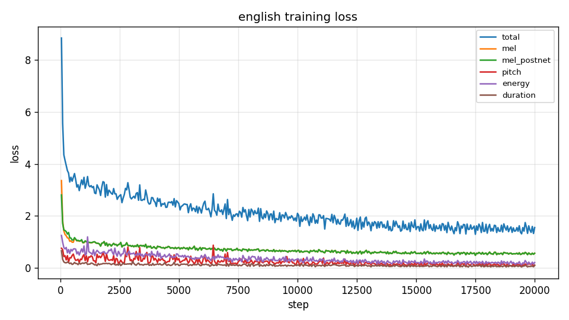

English training loss. The y-axis ticks are 0, 2, 4, 6, and 8, and the axis continues above 8. The total curve starts above the 8 tick, drops steeply in the first part of the axis, then declines slowly with visible noise through the 20000 tick. After that early drop the other five curves stay below the total.

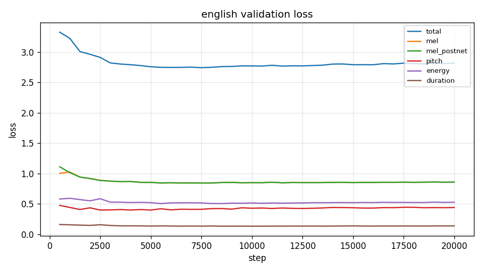

English validation loss. The y-axis ticks run from 0.0 to 3.0 in steps of 0.5. The curve matches the table: 3.3283 at step 500, 2.7435 at step 7500, 2.7723 at step 10000, and 2.8197 at step 20000. The component curves sit below the total. The log has no `NaN` line.

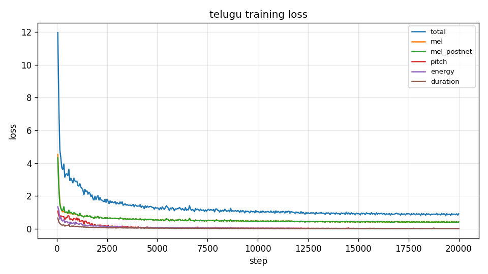

Telugu training loss. The y-axis ticks run from 0 to 12 in steps of 2. The total curve starts near the top of the axis, drops steeply, and is then low and slowly changing through the 20000 tick. The component curves fall with it and remain below the total.

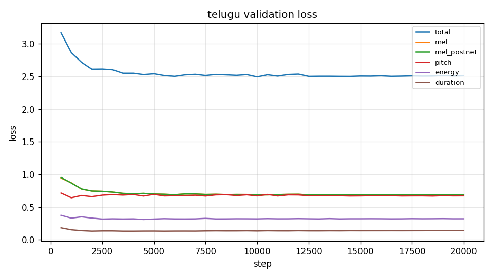

Telugu validation loss. The y-axis ticks match the English validation figure (0.0 to 3.0 by 0.5). The log totals are 3.1647 at step 500, 2.4912 at step 10000, and 2.5084 at step 20000. Step 10000 is the lowest of the 40 validation lines.

## 6. Sample outputs

Synthesis entry points are `English/inference.py` and `Telugu/inference.py` (both call `scripts/synthesize.py`). The test strings are `data/test_sentences/english.json` and `data/test_sentences/telugu.json`, copied with the doubled spaces kept.

Each wav in the repository is mono, 16-bit PCM, 22050 Hz. The durations below are `n_frames / 22050` from those files. They are file lengths, not a listening score.

| ID | Wav file duration (s) | Phone tokens | of which `sp` |
| --- | ---: | ---: | ---: |
| E1 | 5.526 | 85 | 0 |
| E2a | 3.367 | 50 | 0 |
| E2b | 3.750 | 56 | 0 |
| E3 | 2.450 | 38 | 1 |
| E4 | 4.807 | 77 | 0 |
| T1 | 2.299 | 38 | 5 |
| T2a | 1.974 | 21 | 5 |
| T2b | 1.533 | 23 | 5 |
| T3 | 2.055 | 20 | 5 |
| T4 | 2.485 | 51 | 12 |

### 6.1 English phone strings

The first line of each `*.phones.txt` is the phone string written at synthesis. The second line is the sentence.

E1:

```
{DH AH0 AE2 N T AY0 D IH0 S AH0 S T AE2 B L IH0 SH M AH0 N T EH1 R IY0 AH0 N IH0 Z AH0 M M UW1 V M AH0 N T G EY1 N D K AH0 N S IH1 D ER0 AH0 B AH0 L M OW0 M EH1 N T AH0 M D ER1 IH0 NG DH AH0 P AA2 R L AH0 M EH1 N ER0 IY0 P R AH0 S IY1 D IH0 NG Z}
```

E2a (`conduct` is `K AA1 N D AH0 K T`):

```
{DH AH0 AO1 R K AH0 S T R AH0 Z K AA1 N D AH0 K T D ER1 IH0 NG DH AH0 S EH1 R AH0 M OW2 N IY0 W AA1 Z P R EY1 Z D B AY1 DH AH0 AA1 D IY0 AH0 N S}
```

E2b (`conduct` is the same stress pattern, `K AA1 N D AH0 K T`):

```
{DH AH0 R IY1 S ER0 CH ER0 Z W AH0 L K AA1 N D AH0 K T AE1 N IH0 K S P EH1 R AH0 M AH0 N T T AH0 IH0 V AE1 L Y UW0 EY2 T DH AH0 P R AH0 P OW1 Z D M EH1 TH AH0 D}
```

E3 (one `sp` inside `rhyth  m`):

```
{DH AH0 R AY1 DH sp EH1 M AH0 V DH AH0 AO1 R K AH0 S T R AH0 CH EY1 N JH D AH2 N IH0 K S P EH1 K T IH0 D L IY0}
```

E4. The cleaner expanded the time and the date in the phone string (`T EH1 N F AO1 R T IY0 F AY1 V` for 10:45, `T W EH1 L V` for 12, `N OW0 V EH1 M B ER0` for November, `T W EH1 N IY0 T W EH1 N IY0 S IH1 K S` for 2026). `andaroo` is `AE0 N D AA1 R OW0`. There is no separate OOV log for English.

```
{DH AH0 M IY1 T IH0 NG W AH0 L S T AA1 R T AE1 T T EH1 N F AO1 R T IY0 F AY1 V AE1 M AA1 N T W EH1 L V N OW0 V EH1 M B ER0 T W EH1 N IY0 T W EH1 N IY0 S IH1 K S S OW1 AE0 N D AA1 R OW0 SH UH1 D ER0 AY1 V AA1 N T AY1 M}
```

The English results folder does not repeat the speaker id. The subset log names `female_nepali_westbengal_865d1b82` as `recommended_speaker`.

### 6.2 Telugu phone strings and the OOV log

`Results/Telugu/test_generated_audios/oov_backoff_log.txt` is the only backoff log in the repository. The full file is:

```
T1	[('శ్లే', ['శ', 'ల'])]
T4	[('2', []), ('0', []), ('2', []), ('6', []), ('1', []), ('2', []), ('1', []), ('0', []), (':', []), ('4', []), ('5', [])]
```

T1. The log says the unseen syllable `శ్లే` was replaced by the known characters `శ` and `ల`. The phone string contains `వి శ ల షిం చా రు` where the sentence still has `విశ్లేషించారు`.

```
{న్యూ రో ఫా ర్మ కో లా జి క ల్ sp ప రి శో ధ న లో sp నూ త న sp ఔ ష ధా ల sp ప్ర భా వా న్ని sp వి శ ల షిం చా రు .}
```

T2a and T2b keep `పట్టు` as the syllables `ప ట్టు` in both sentences (grip in T2a, silk sari in T2b). The phone files do not mark a different pronunciation for the two uses.

```
{తా డు పై sp అ త ని sp ప ట్టు sp చా లా sp బ లం గా sp ఉం ది .}
```

```
{ఆ మె sp ప ట్టు sp చీ ర ను sp ధ రిం చి sp వే డు క కు sp వ చ్చిం ది .}
```

T3. The doubled space in `అడ  విలో` is two `sp` tokens: `అ డ sp sp వి లో`.

```
{పు లి sp అ డ sp sp వి లో sp ని శ్శ బ్దం గా sp న డి చిం ది .}
```

T4. Every digit and the colon in `2026`, `12`, and `10:45` is logged with an empty backoff (`[]`), so those characters were dropped. The phone string has no digit tokens and no spoken-number tokens. The sentence line in `T4.phones.txt` still contains the original digits.

```
{ఈ sp స మా వే శం sp sp న వం బ ర్ sp వ sp తే దీ sp ఉ ద యం sp sp గం ట ల కు sp ప్రా రం భ మ వు తుం ది , sp స మ యా ని కి sp సి ద్ధం గా sp ఉం చం డి .}
```

Telugu synthesis speaker, from `Results/Telugu/README.md`: `female`, id 0.

## 7. Observations from the variance plots

`scripts/plot_variance.py` draws three figures per sentence from `variance_adaptor_plots/_predictions/*.npz`: duration in mel frames, F0 in Hz after denormalization, and energy after denormalization. The npz files are gitignored and are not in the repository, so bar heights and curve samples are not available as numbers. The notes below use only the axis labels that are printed on the pngs, the phone strings in section 6, and the shape of the figure. They are not a listening test.

The figures for every test id are included so the PDF contains the same plots as `Results/`.

### 7.1 English

English duration axes that were checked (E1 and E3) are labeled in mel frames with ticks at 0, 2, 4, 6, and 8. The bars vary from phone to phone and stay on that scale. E1 does not put the whole of `antidisestablishmentarianism` on one bar. The duration is spread across the ARPAbet sequence in section 6.

E2a and E2b both label `conduct` as `K AA1 N D AH0 K T`. The phone strings and the duration tick labels therefore show one stress pattern for the noun sentence and the verb sentence. A second stress pattern is not present in the committed phone files.

E3's duration figure includes the `sp` token between `DH` and `EH1`. The energy figure for E3 is labeled from 0 to 140 in steps of 20 and moves across that scale. What that `sp` sounds like belongs in section 8.

E2a pitch is labeled in denormalized Hz with ticks from 140 to 260 in steps of 20. The curve moves up and down across that labeled range. It is not a flat line. E2b's pitch figure also moves. A numeric F0 difference on the shared `conduct` phones is not in the logs, because the prediction npz files are still gitignored.

E4's phone string shows that 10:45, 12 November 2026, and `andaroo` were all given ARPAbet tokens (section 6). The listening note for that file is the E4 bullet in section 8.

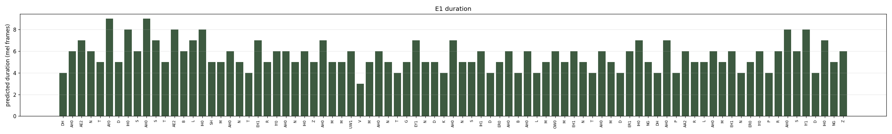

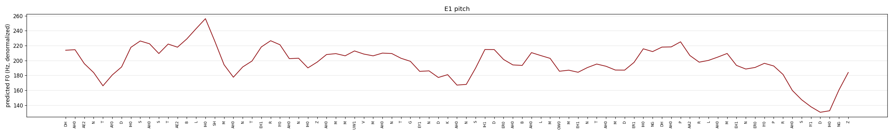

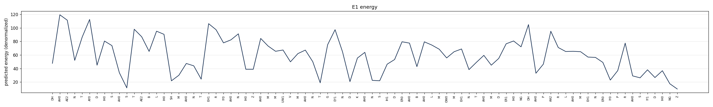

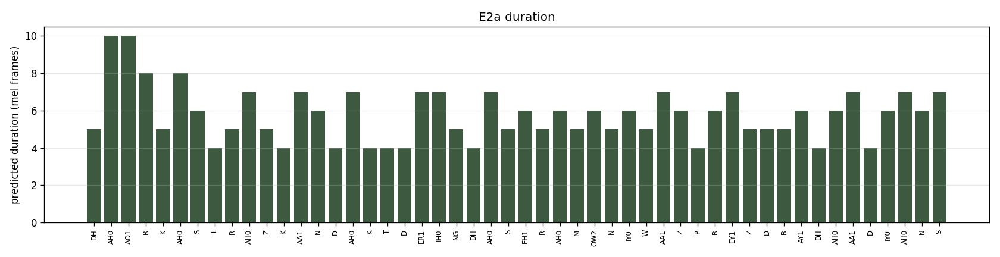

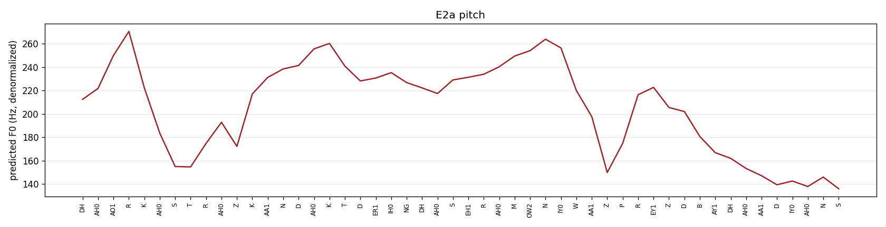

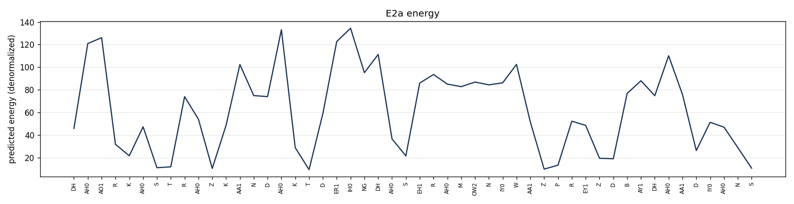

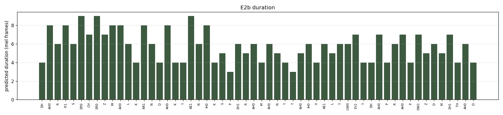

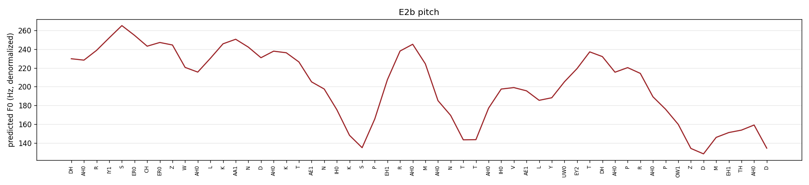

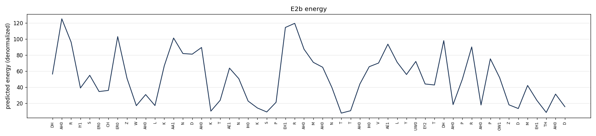

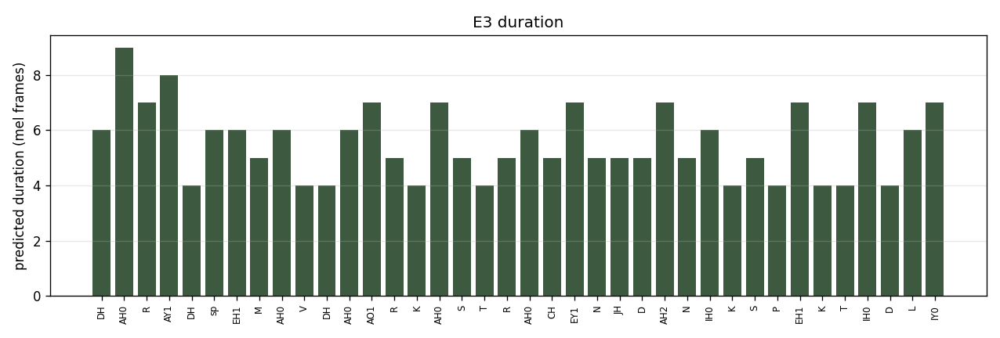

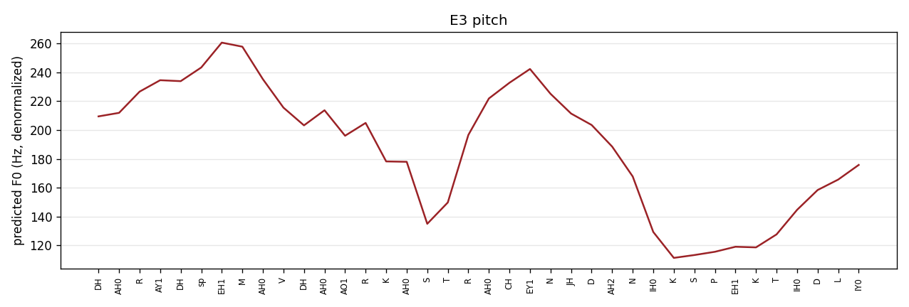

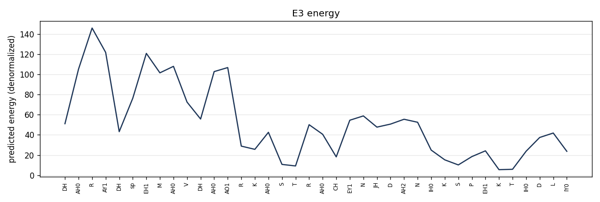

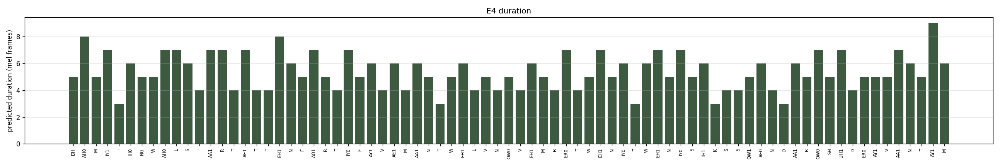

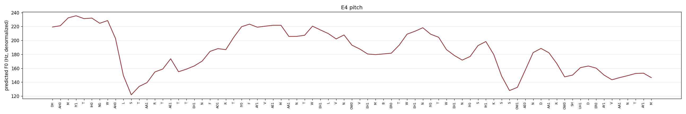

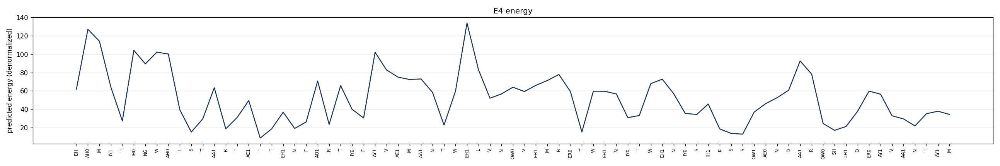

### 7.2 Telugu

Telugu duration scales are larger than the English ones where a single bar dominates. Checked y-axis ticks: T1 runs to 80 mel frames in steps of 10, T3 runs to 100 in steps of 20, and T4 runs to 50 in steps of 10. On each of those three figures, one bar near the right edge is far taller than the other bars, which sit in the lower part of the scale. The token that owns that bar is not recoverable without the npz. On the T1 and T2a duration pngs, the syllable tick labels are empty boxes. The Latin token `sp` is readable. Matplotlib did not have a Telugu font when those figures were drawn. The syllable sequence is the phone file in section 6, not the plot axis. T2a and T2b duration figures are in the set below and are not given a numeric reading here.

T2a and T2b pitch figures are curves that rise and fall, not flat lines. They do not, by themselves, show two pronunciations of `పట్టు`. The phone strings in section 6 use the same syllables `ప ట్టు` in both sentences.

T3's phone string has two consecutive `sp` tokens inside `అడవిలో`. T4's phone string omits the date and the clock time, matching the empty backoffs in the OOV log. The duration and energy plots for T4 therefore cannot show phones that were never synthesized.

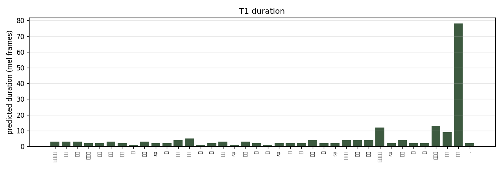

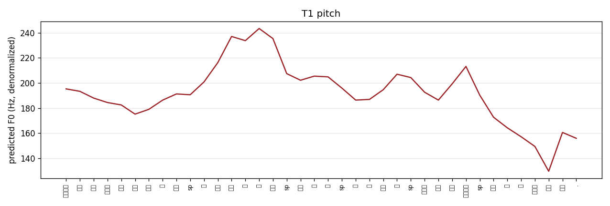

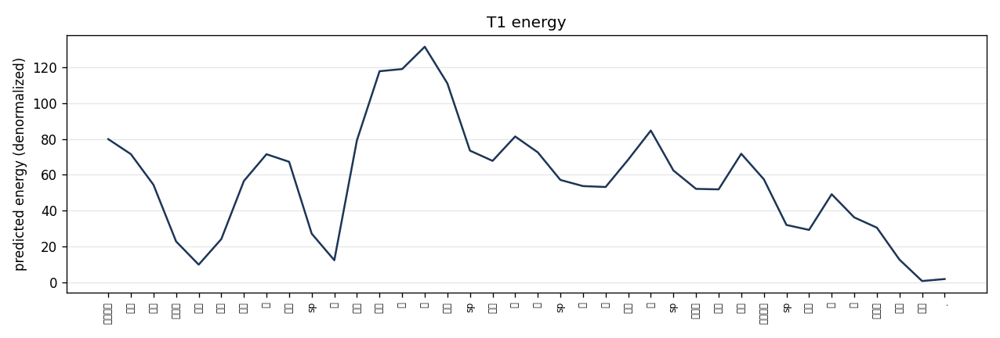

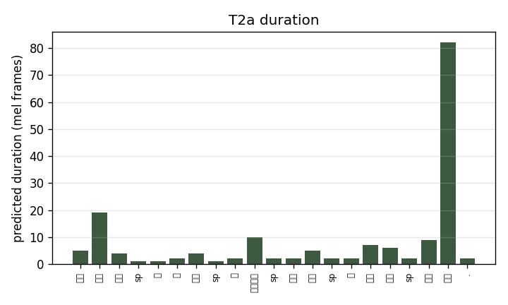

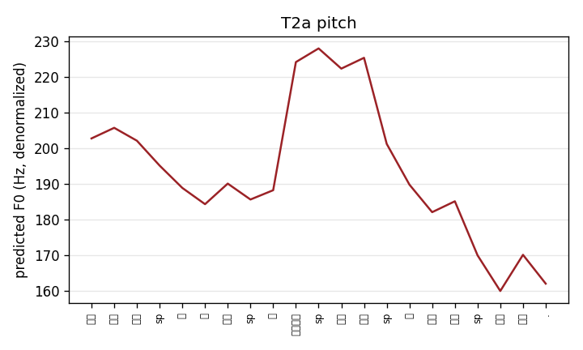

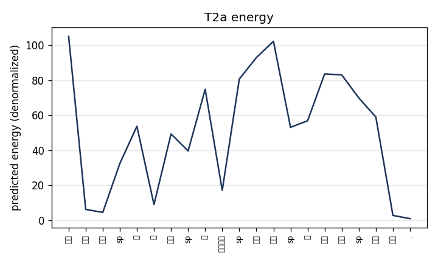

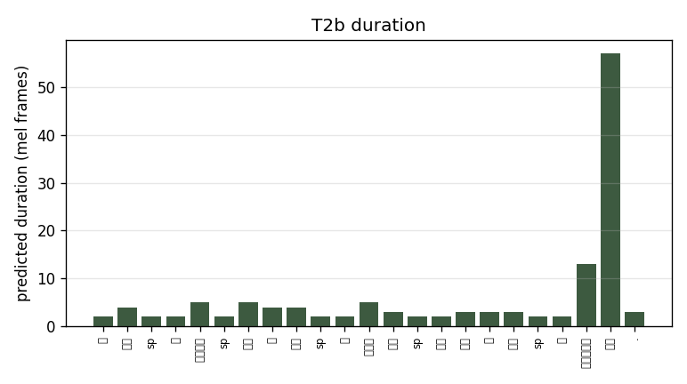

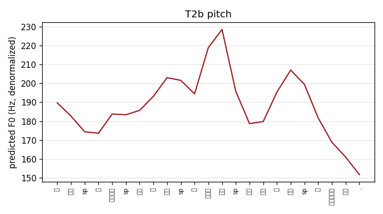

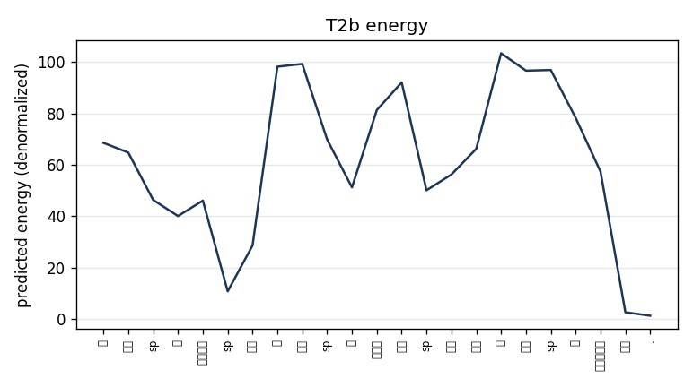

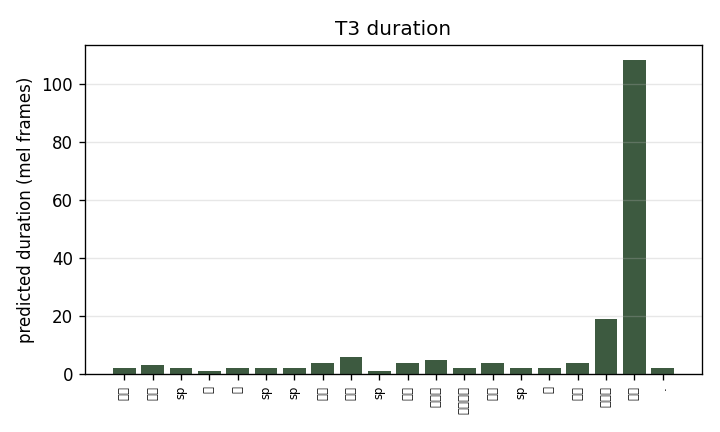

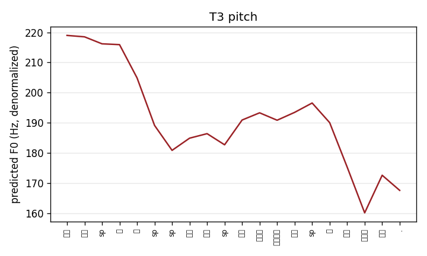

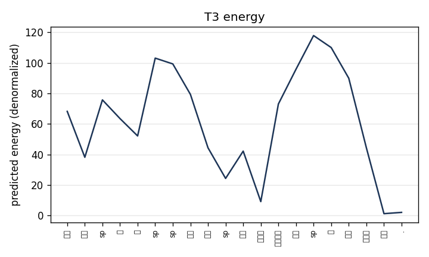

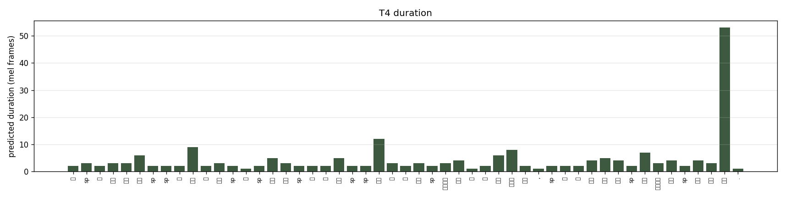

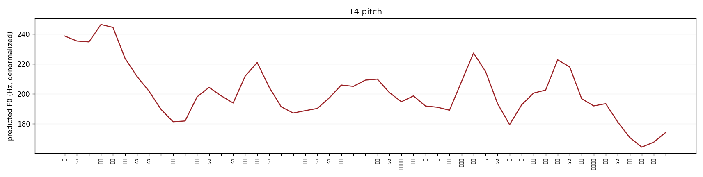

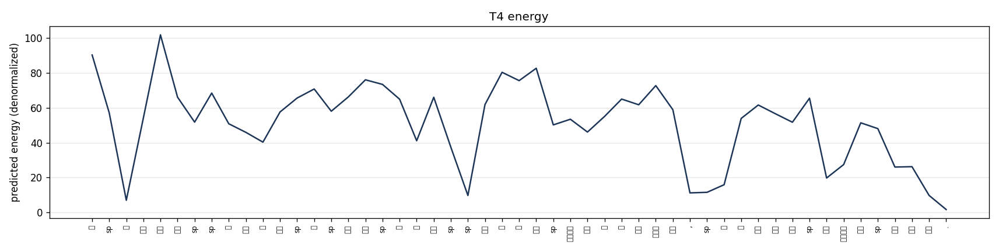

## 8. Listening observations (to be filled by author)

Author notes only. The loss logs do not say how the wavs sound. Replace each `[author]` with one sentence after listening.

- E1, `Results/English/test_generated_audios/E1.wav` (long word `antidisestablishmentarianism`): [author]
- E2a, `Results/English/test_generated_audios/E2a.wav` (noun `conduct`, phones `K AA1 N D AH0 K T`): [author]
- E2b, `Results/English/test_generated_audios/E2b.wav` (verb `conduct`, same phones `K AA1 N D AH0 K T`): [author]
- E3, `Results/English/test_generated_audios/E3.wav` (one `sp` inside `rhyth  m`): [author]
- E4, `Results/English/test_generated_audios/E4.wav` (time, date, and `andaroo`): [author]
- T1, `Results/Telugu/test_generated_audios/T1.wav` (`శ్లే` backed off to `శ` and `ల`): [author]
- T2a, `Results/Telugu/test_generated_audios/T2a.wav` (`పట్టు` as grip): [author]
- T2b, `Results/Telugu/test_generated_audios/T2b.wav` (`పట్టు` as silk sari, same syllables): [author]
- T3, `Results/Telugu/test_generated_audios/T3.wav` (two `sp` tokens inside `అడవిలో`): [author]
- T4, `Results/Telugu/test_generated_audios/T4.wav` (`2026`, `12`, and `10:45` dropped): [author]

## 9. Limitations

These are either properties of the setup or gaps in what was committed. They are not invented error rates.

- The English alignment skip count is not in the tarball. Telugu skipped 8 of 2437 slices, all `tokenizer produced <unk>`.
- The pitch and energy scaler (`stats.json`) is not in the logs, so plot means and standard deviations are not listed here.
- The train logs do not print batch size, accelerator, or wall-clock time.
- The hosted English weight is step 10000, which matches the recommendation in section 5. The hosted Telugu weight is step 20000, whose validation total (2.5084) is worse than step 10000 (2.4912). A `te/10000.pth.tar` file is not on the Hugging Face repo.
- `Results/English/README.md` does not repeat `recommended_speaker`. The log does: `female_nepali_westbengal_865d1b82`.
- The universal HiFi-GAN was not fine-tuned on Svarah or IndicTTS. The logs do not split vocoder error from acoustic-model error.
- Svarah is accented, multi-speaker, partly spontaneous ASR audio, with a proxy speaker id. IndicTTS Telugu is two studio speakers. That difference is a property of the corpora, not a measured quality gap.
- English phones come from a US English lexicon plus `g2p-en`. E2a and E2b are evidence in the phone files: one spelling of `conduct` received one stress pattern.
- CTC alignment projected onto phones is not MFA. Word-internal timing is a weight. MFA was not recorded as the aligner for these artifacts.
- Telugu has no number normalizer. T4 dropped the digits. T1 replaced one unseen syllable with two characters.
- Variance-plot numbers cannot be recovered. The npz files are gitignored.
- Section 8 is an author placeholder. The brackets are not listening scores.
- The course Google Form is not a file in this repository. Submission of the public URL is not recorded here.

## 10. Future work

- Put an English `align_report.json` next to the Telugu one if that run still has it.
- Upload `te/10000.pth.tar` if synthesis should use the validation minimum instead of the hosted step 20000 file.
- Write the English `recommended_speaker` into `Results/English/README.md`.
- Fill section 8 after listening. Do not back-fill it from the loss table.
- Add Telugu number-to-word normalization so T4 keeps `2026`, `12`, and `10:45`.
- Keep unseen Telugu syllables in the vocabulary, or add a Telugu G2P, instead of backing `శ్లే` off to `శ` and `ల`.
- Use an Indian-English lexicon if noun and verb `conduct` should not share `K AA1 N D AH0 K T`.
- Run English alignment with Montreal Forced Aligner (`english_us_arpa`) if phone-level durations need a phone recognizer rather than a split of the CTC word span. Telugu still has no MFA model in this scaffold.
- Fine-tune the universal HiFi-GAN on the same subsets, or at least compare a mel inspection with the wav, so vocoder error is separate from acoustic-model error.
- The configs still name 20000 as `total_step`. The logs already reach that step. Further training is a later run. Section 5 recommends stopping at step 10000 for synthesis.

## 11. Reproducibility

| Item | Location |
| --- | --- |
| Code | this repository, `third_party/FastSpeech2` and `scripts/` |
| English config | `configs/english.yaml` |
| Telugu config | `configs/telugu.yaml` |
| Dependencies | `requirements.txt`, `requirements-kaggle.txt` |
| Download | `scripts/download_svarah.py`, `scripts/download_indictts.py` |
| Align and features | `English/preprocess.py`, `Telugu/preprocess.py` |
| Train | `English/train.py`, `Telugu/train.py` |
| Synthesize | `English/inference.py`, `Telugu/inference.py` |
| Loss plots | `scripts/plot_losses.py` |
| Variance plots | `scripts/plot_variance.py` |
| English results | `Results/English/` |
| Telugu results | `Results/Telugu/` |
| English Kaggle logs | `logs/english_svarah/` |
| Telugu Kaggle logs | `logs/telugu_indictts/` |
| English checkpoint | https://huggingface.co/akshaikrishna/fastspeech2-svarah-indictts/resolve/main/en/10000.pth.tar |
| Telugu checkpoint | https://huggingface.co/akshaikrishna/fastspeech2-svarah-indictts/resolve/main/te/20000.pth.tar |
| This PDF | `Report/Technical_Report.pdf` |

The subset seed in the configs and in both `split_stats.json` files is 42. Training itself is not given a seed beyond PyTorch's default. Cite step 10000 for synthesis. The Telugu results README records a step 20000 synthesis, and that file is the one on Hugging Face.
